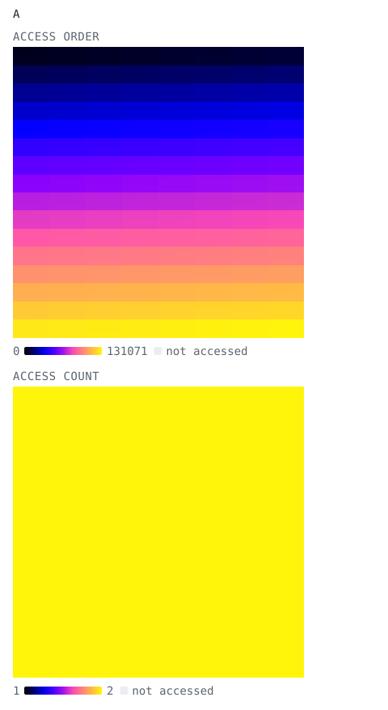
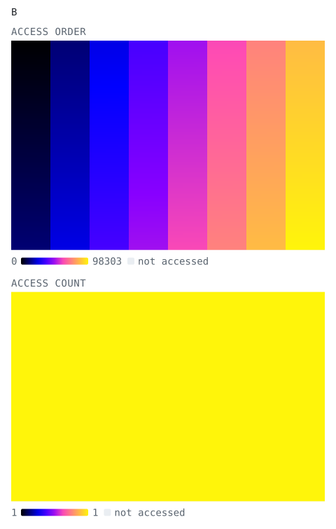
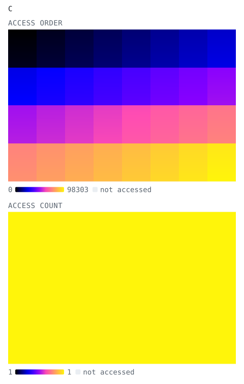
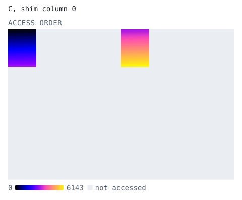
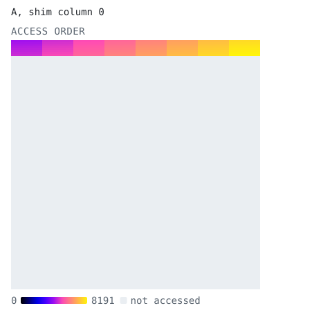
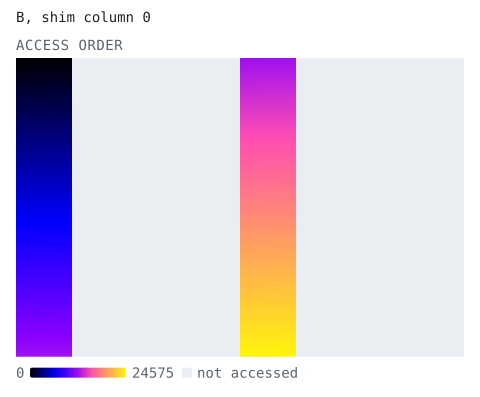

<!-- Copyright (C) 2024-2026 Advanced Micro Devices, Inc.
SPDX-License-Identifier: Apache-2.0 WITH LLVM-exception -->

# Whole-array matrix multiply: how A, B and C are tiled

This page shows how the [whole-array design](README.md) tiles the A, B and C
matrices and which tiles each shim DMA transfer moves.

The design tiles each matrix once, with `tile_matrices()`. A tiling is itself
a `TensorAccessPattern` (from [taplib](../../tiling_exploration/introduction/README.md))
whose leading dimensions index the tiles, so indexing or slicing those
dimensions picks out the tiles one DMA transfer moves. `step_transfers()`
lists those slices for one row block of C, and the runtime sequence fills or
drains each of them. The code below imports both functions from
`whole_array.py`. It only builds access patterns, so it needs neither a
compiler nor an NPU.

## Tile the matrices

The problem here is smaller than the design's default, so that each tile
stays visible in the pictures. The tile sizes are the default ones.

```python
from whole_array import step_transfers, tile_matrices

M, K, N = 256, 256, 384
m, k, n = 16, 32, 48
n_aie_cols = 4

tilings = tile_matrices(M, K, N, m, k, n, n_aie_cols, b_col_maj=False, c_col_maj=False)
for name, tiling in zip("ABC", tilings):
    print(name, tiling)
```
<!-- tapbook:begin -->
```text
A TensorAccessPattern([256, 256], offset=0, sizes=[16, 2, 8, 16, 32], strides=[4096, 0, 32, 256, 1])
B TensorAccessPattern([256, 384], offset=0, sizes=[8, 8, 32, 48], strides=[48, 12288, 384, 1])
C TensorAccessPattern([256, 384], offset=0, sizes=[4, 8, 64, 48], strides=[24576, 48, 384, 1])
```
<!-- tapbook:end -->

`tilings.A` has sizes `[M // m, N // n // n_aie_cols, K // k, m, k]`:
`tilings.A[i]` is the i-th row of A tiles, walked once for every column of
output tiles a shim column computes. `tilings.B` has sizes
`[N // n, K // k, k, n]`, one column of B tiles per index of its first
dimension. `tilings.C` has sizes `[M // (4 * m), N // n, 4 * m, n]`:
`tilings.C[i, j]` is the C tile the four cores of column `j` produce for row
block `i`.

In the pictures, the *access order* heatmap shows the order in which elements
go onto or come off the stream, from black (first) to yellow (last). The
*access count* heatmap shows how many times each element is moved. It is one
color when every element moves the same number of times.

## The whole tilings

```python
tilings.A.visualize(title="A", plot_access_count=True)
```
<!-- tapbook:begin -->
<p align="center"><picture><source media="(prefers-color-scheme: dark)" srcset="assets/tiling-the-whole-tilings-1.dark.svg"></picture></p>
<!-- tapbook:end -->

Every element of A is moved `N // n // n_aie_cols` times: the `repeat()` in
its tiling.

```python
tilings.B.visualize(title="B", plot_access_count=True)
```
<!-- tapbook:begin -->
<p align="center"><picture><source media="(prefers-color-scheme: dark)" srcset="assets/tiling-the-whole-tilings-2.dark.svg"></picture></p>
<!-- tapbook:end -->

```python
tilings.C.visualize(title="C", plot_access_count=True)
```
<!-- tapbook:begin -->
<p align="center"><picture><source media="(prefers-color-scheme: dark)" srcset="assets/tiling-the-whole-tilings-3.dark.svg"></picture></p>
<!-- tapbook:end -->

## One row block's transfers

The runtime sequence issues `step_transfers(tilings, row, n_aie_cols)` for
each row block `row`. Shim column `col` drains every `n_aie_cols`-th C tile of
the row block, fills the row of A tiles its core row multiplies, and fills
every `n_aie_cols`-th column of B. These are shim column 0's transfers for row
block 0:

```python
for tensor, col, tap in step_transfers(tilings, 0, n_aie_cols):
    if col == 0:
        print(tensor, tap)
        tap.visualize(title=f"{tensor}, shim column {col}")
```
<!-- tapbook:begin -->
```text
C TensorAccessPattern([256, 384], offset=0, sizes=[2, 64, 48], strides=[192, 384, 1])
```

<p align="center"><picture><source media="(prefers-color-scheme: dark)" srcset="assets/tiling-one-row-block-s-transfers-1.dark.svg"></picture></p>

```text
A TensorAccessPattern([256, 256], offset=0, sizes=[2, 8, 16, 32], strides=[0, 32, 256, 1])
```

<p align="center"><picture><source media="(prefers-color-scheme: dark)" srcset="assets/tiling-one-row-block-s-transfers-2.dark.svg"></picture></p>

```text
B TensorAccessPattern([256, 384], offset=0, sizes=[2, 8, 32, 48], strides=[192, 12288, 384, 1])
```

<p align="center"><picture><source media="(prefers-color-scheme: dark)" srcset="assets/tiling-one-row-block-s-transfers-3.dark.svg"></picture></p>
<!-- tapbook:end -->

## The tilings, one step at a time

`animate(frame_dims=1)` draws one frame per index of a tiling's first
dimension: one row of A tiles, one column of B tiles, or one row block of C.

### A, one row of tiles per frame

```python
tilings.A.animate(frame_dims=1, title="A")
```
<!-- tapbook:begin -->
<p align="center"><picture><source media="(prefers-color-scheme: dark)" srcset="assets/tiling-a-one-row-of-tiles-per-frame-1.dark.svg"></picture></p>
<!-- tapbook:end -->

### B, one column of tiles per frame

```python
tilings.B.animate(frame_dims=1, title="B")
```
<!-- tapbook:begin -->
<p align="center"><picture><source media="(prefers-color-scheme: dark)" srcset="assets/tiling-b-one-column-of-tiles-per-frame-1.dark.svg"></picture></p>
<!-- tapbook:end -->

### C, one row block per frame

```python
tilings.C.animate(frame_dims=1, title="C")
```
<!-- tapbook:begin -->
<p align="center"><picture><source media="(prefers-color-scheme: dark)" srcset="assets/tiling-c-one-row-block-per-frame-1.dark.svg"></picture></p>
<!-- tapbook:end -->

## Running this page

With the mlir-aie environment set up (`utils/setup_env.sh`), `make tiling`
in this directory runs the code blocks above in order. The pictures are
generated from the same blocks by `iron-explorer tapbook tiling.md`.
