<!-- Copyright (C) 2024-2026 Advanced Micro Devices, Inc.
SPDX-License-Identifier: Apache-2.0 WITH LLVM-exception -->

# `taplib`, part 1: building tensor access patterns

This is the first of two pages about the Tensor Access Pattern Library
(`taplib`), the IRON tool for data movements and tiling. This part builds
patterns: tiling, permuting, slicing and repeating.
[Part 2](part2.md) goes further, with hierarchical tiling, padding, what a
DMA can walk, and chaining patterns to follow data from the host to a core.

Every picture on these pages is drawn from the code block above it. To run
the code yourself, see [Running these pages](#running-these-pages).

## Introduction

Components of *AI Engines* (AIEs) have *Direct Memory Access channels* (DMAs) which are capable of expressing complex on-the-fly data transformations.

The primary purpose of `taplib` is to provide building blocks for expressing *Tensor Access Patterns* (*taps*) used in DMA transformations. Rather than asking you to write offsets, sizes and strides by hand, `taplib` provides a small algebra over taps: tiling, transposing, slicing and repeating are all compositions of a few operations on a `TensorAccessPattern`.

*tiling* is a common type of transformation whereby a larger *image* or *tensor* of data is broken up into smaller *tiles* or groups of tiles. This can be done to encourage smooth streaming behavior, to better conserve resources at specific areas of the memory hierarchy, or because applications or vectorized instructions require data to be structured in a specific way. `TensorAccessPattern.tile()` generates taps for common tiling patterns.

## Data Transformations in MLIR

Internally, the `mlir-aie` dialect represents tensor access patterns as a combination of an *offset* into a region of data, a set of *strides*, and a set of *sizes*. Most of the DMAs take either 4 dimensions of offsets/sizes/strides or 3 dimensions + a repeat count with a repeat step (which is, for the most part, functionally equivalent to 4 dimensions of sizes/strides).

It takes practice to successfully think about data movements in offsets/sizes/strides; that is why `taplib` provides some tools to help reason about tensor access patterns.

## `taplib`

Everything in `taplib` is built from one class:

```python
from aie.helpers.taplib import TensorAccessPattern
```

### `TensorAccessPattern` (`tap`)

A `TensorAccessPattern` represents a single set of offset/sizes/strides on a tensor of a particular shape. Let's look at some examples of what you can do with a `TensorAccessPattern`.

```python
# Create a TensorAccessPattern
tensor_dims = (2, 3)
offset = 4
sizes = [1, 2]
strides = [0, 1]
tap = TensorAccessPattern((2, 3), offset=offset, sizes=[1, 2], strides=[0, 1])
```

The `TensorAccessPattern` can be visualized in two ways:
- as a heatmap showing the order that elements are accessed
- as a heatmap showing the number of times each element in the tensor is accessed by the `TensorAccessPattern`

```python
# We can visualize the TensorAccessPattern
tap.visualize(show_arrows=False)
```
<!-- tapbook:begin -->
<p align="center"><picture><source media="(prefers-color-scheme: dark)" srcset="assets/introduction-tensoraccesspattern-tap-1.dark.svg">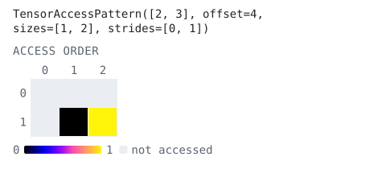</picture></p>
<!-- tapbook:end -->

```python
# We can add some arrows to the visualization, and optionally plot the access count.
tap.visualize(show_arrows=True, plot_access_count=True)
```
<!-- tapbook:begin -->
<p align="center"><picture><source media="(prefers-color-scheme: dark)" srcset="assets/introduction-tensoraccesspattern-tap-2.dark.svg">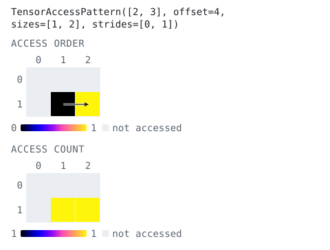</picture></p>
<!-- tapbook:end -->

These graphs are based off of *access tensors* which contain either order or count information, respectively.

```python
access_order, access_count = tap.accesses()
access_order, access_count
```
<!-- tapbook:begin -->
```text
(array([[-1, -1, -1],
       [-1,  0,  1]]), array([[0, 0, 0],
       [0, 1, 1]]))
```
<!-- tapbook:end -->

There are also methods to get just one of the access tensors, if desired. For larger tensors, it's useful to only calculate what you need to reduce program memory/computation.

```python
access_order = tap.access_order()
access_count = tap.access_count()
```

### Lists of taps

Several taps are kept in a plain Python list, for example one tap per tile of a tiling pattern.

```python
t0 = TensorAccessPattern((8, 8), offset=0, sizes=[4, 4], strides=[8, 1])
t1 = TensorAccessPattern((8, 8), offset=4, sizes=[4, 4], strides=[8, 1])
t2 = TensorAccessPattern((8, 8), offset=32, sizes=[4, 4], strides=[8, 1])

taps = [t0, t1, t2]
for t in taps:
    t.visualize()
```
<!-- tapbook:begin -->
<p align="center"><picture><source media="(prefers-color-scheme: dark)" srcset="assets/introduction-lists-of-taps-1.dark.svg">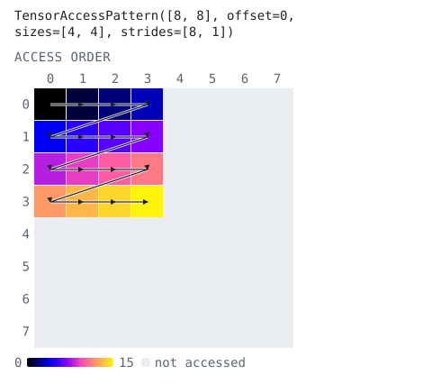</picture></p>

<p align="center"><picture><source media="(prefers-color-scheme: dark)" srcset="assets/introduction-lists-of-taps-2.dark.svg">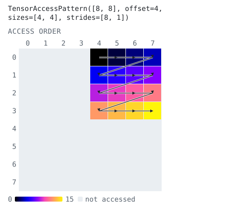</picture></p>

<p align="center"><picture><source media="(prefers-color-scheme: dark)" srcset="assets/introduction-lists-of-taps-3.dark.svg">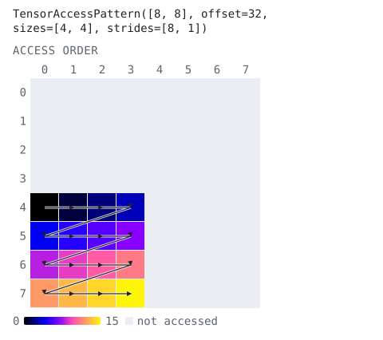</picture></p>
<!-- tapbook:end -->

### Tiling

Writing each tile's tap down by hand is arduous. Instead of writing the numbers down, you can build a tap by composing operations, starting from the walk over a whole tensor:

- `TensorAccessPattern.full(dims)` is the row-major walk over a whole tensor.
- `.tile(tile_dims)` divides every dimension into equal tiles. The result is again a `TensorAccessPattern`: its leading dimensions index the grid of tiles and its trailing dimensions walk one tile.
- Indexing the grid dimensions picks out tiles: `tiles[i, j]` is one tile, `tiles[i]` is the `i`-th row of tiles, and slices such as `tiles[0:2, 0:2]` keep a block of tiles in a single tap. Iterating yields `tiles[0]`, `tiles[1]`, and so on.
- A tiling is refined with the same operations as any other tap: `.permute(axes)` reorders dimensions (visit tiles column by column, or walk each tile column-major), slices with steps skip tiles, `.split(dim, n)` cuts a dimension in two, and `.repeat(n)` walks the pattern `n` times. Each operation returns a new tap.
- `.visualize()` shows the whole walk, and `.animate(frame_dims=2)` shows it one tile per frame.
- A tap goes straight to `fill()` and `drain()`, or to an `ObjectFifo` as `to_stream` / `from_stream_per_cons`; `.transformation_dims` gives the `((size, stride), ...)` pairs it stands for.

```python
# This builds the taps we wrote by hand above, but much more easily!
tensor_dims = (8, 8)
tile_dims = (4, 4)
tiles = TensorAccessPattern.full(tensor_dims).tile(tile_dims)
print(tiles)
print(tiles[0, 0])
print(tiles[1, 0])
```
<!-- tapbook:begin -->
```text
TensorAccessPattern([8, 8], offset=0, sizes=[2, 2, 4, 4], strides=[32, 4, 8, 1])
TensorAccessPattern([8, 8], offset=0, sizes=[4, 4], strides=[8, 1])
TensorAccessPattern([8, 8], offset=32, sizes=[4, 4], strides=[8, 1])
```
<!-- tapbook:end -->

```python
# The tiles are the taps from before, and the tiling animates one tile per frame
print(tiles[0, 0] == t0, tiles[0, 1] == t1, tiles[1, 0] == t2)
tiles.animate(frame_dims=2)
```
<!-- tapbook:begin -->
```text
True True True
```

<p align="center"><picture><source media="(prefers-color-scheme: dark)" srcset="assets/introduction-tiling-1.dark.svg"></picture></p>
<!-- tapbook:end -->

`TensorAccessPattern.tile()` and every other operation are documented in the [taplib reference](../../../../docs/api/taplib.md).

A tiling can be refined before it is indexed. Permuting the grid dimensions changes the order in which tiles are visited; permuting the tile dimensions changes the walk inside each tile. The tensor and the tile shape stay the same.

```python
# Visit the tiles column by column instead of row by row
col_tiles = tiles.permute((1, 0, 2, 3))
print([t.offset for row in tiles for t in row])
print([t.offset for row in col_tiles for t in row])
col_tiles.visualize()
```
<!-- tapbook:begin -->
```text
[0, 4, 32, 36]
[0, 32, 4, 36]
```

<p align="center"><picture><source media="(prefers-color-scheme: dark)" srcset="assets/introduction-tiling-2.dark.svg">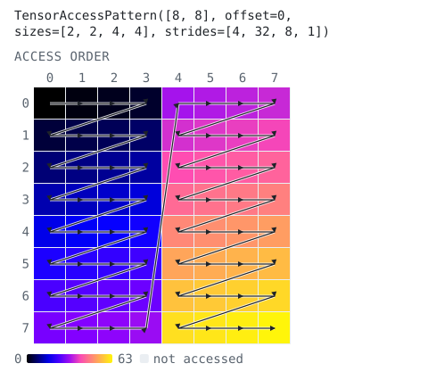</picture></p>
<!-- tapbook:end -->

```python
# Walk each tile column-major (a transpose inside every tile)
print(tiles.permute((0, 1, 3, 2))[0, 0])
tiles.permute((0, 1, 3, 2)).visualize()
```
<!-- tapbook:begin -->
```text
TensorAccessPattern([8, 8], offset=0, sizes=[4, 4], strides=[1, 8])
```

<p align="center"><picture><source media="(prefers-color-scheme: dark)" srcset="assets/introduction-tiling-3.dark.svg">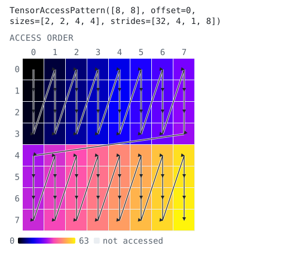</picture></p>
<!-- tapbook:end -->

```python
# Walk the tiling twice: a new outermost dimension with stride 0
print(tiles.repeat(2))
tiles.repeat(2).visualize(plot_access_count=True)
```
<!-- tapbook:begin -->
```text
TensorAccessPattern([8, 8], offset=0, sizes=[2, 2, 2, 4, 4], strides=[0, 32, 4, 8, 1])
```

<p align="center"><picture><source media="(prefers-color-scheme: dark)" srcset="assets/introduction-tiling-4.dark.svg">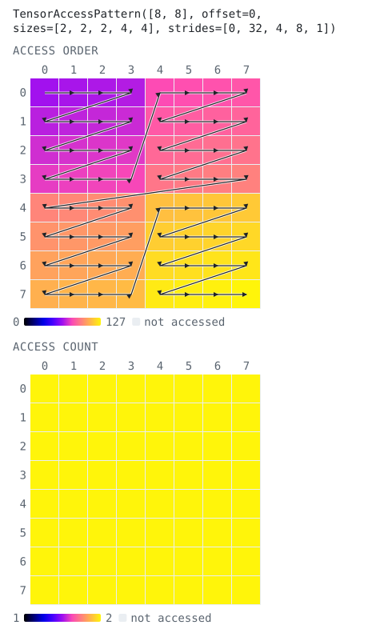</picture></p>
<!-- tapbook:end -->

```python
# There are also more complex tiling patterns, such as groups of tiles.
# A slice of the grid dimensions keeps a block of adjacent tiles in one tap.
tensor_dims = (16, 16)
tile_dims = (4, 4)
tiles = TensorAccessPattern.full(tensor_dims).tile(tile_dims)
group = tiles[0:2, 0:2]
print(group)
```
<!-- tapbook:begin -->
```text
TensorAccessPattern([16, 16], offset=0, sizes=[2, 2, 4, 4], strides=[64, 4, 16, 1])
```
<!-- tapbook:end -->

```python
# split() cuts each grid dimension into groups of 2 tiles; permute() brings the two group dimensions to
# the front, so the result walks the tensor one 2 x 2 group of tiles at a time
groups = tiles.split(0, 2).split(2, 2).permute((0, 2, 1, 3, 4, 5))
print(groups)
print(groups[0, 0] == group)
groups.animate(frame_dims=2)
```
<!-- tapbook:begin -->
```text
TensorAccessPattern([16, 16], offset=0, sizes=[2, 2, 2, 2, 4, 4], strides=[128, 8, 64, 4, 16, 1])
True
```

<p align="center"><picture><source media="(prefers-color-scheme: dark)" srcset="assets/introduction-tiling-5.dark.svg"></picture></p>
<!-- tapbook:end -->

```python
# A slice with a step makes non-contiguous groups of tiles: this group gathers tiles that lie 2 tiles apart
tensor_dims = (32, 32)
tile_dims = (4, 4)
step_group = TensorAccessPattern.full(tensor_dims).tile(tile_dims)[0:4:2, 0:4:2]
print(step_group)
```
<!-- tapbook:begin -->
```text
TensorAccessPattern([32, 32], offset=0, sizes=[2, 2, 4, 4], strides=[256, 8, 32, 1])
```
<!-- tapbook:end -->

```python
step_group.animate(frame_dims=2)
```
<!-- tapbook:begin -->
<p align="center"><picture><source media="(prefers-color-scheme: dark)" srcset="assets/introduction-tiling-6.dark.svg"></picture></p>
<!-- tapbook:end -->

```python
# The tile order and the walk inside each tile compose in one permute(): here tiles are visited
# column by column and each tile is walked column-major.
combined = TensorAccessPattern.full((16, 16)).tile((4, 4)).permute((1, 0, 3, 2))
print([t.offset for row in combined for t in row])
print(combined[0, 0])
combined.visualize()
```
<!-- tapbook:begin -->
```text
[0, 64, 128, 192, 4, 68, 132, 196, 8, 72, 136, 200, 12, 76, 140, 204]
TensorAccessPattern([16, 16], offset=0, sizes=[4, 4], strides=[1, 16])
```

<p align="center"><picture><source media="(prefers-color-scheme: dark)" srcset="assets/introduction-tiling-7.dark.svg">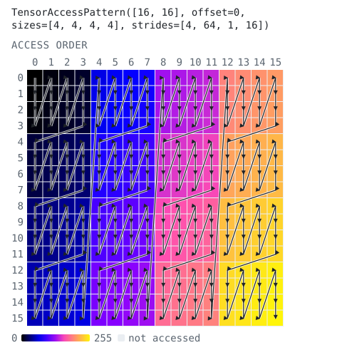</picture></p>
<!-- tapbook:end -->

### Other views

Not every access pattern is a tiling. The operations above work on any `TensorAccessPattern`, along with a few more:

- `.partition(k)` cuts a dimension into `k` equal contiguous chunks (the per-column or per-channel split most designs write by hand as `[1, 1, 1, N // k]`).
- NumPy-style indexing (`tap[key]`) restricts a view to a sub-region, with steps.
- `.permute(axes)` reorders the dimensions of a view, and `.T` reverses them, which is how a transpose is expressed.
- `.coalesce()` returns the view with the fewest dimensions that visits the same elements in the same order.
- `tiles.inverse()` is the walk that reads a tile-blocked buffer back in logical row-major order, i.e. the "un-blocking" pattern a memory tile applies to a core's blocked output.

```python
# Equal chunks of a flat range
chunks = TensorAccessPattern.full((1024,)).partition(4)
print(chunks)
print(chunks[1])
```
<!-- tapbook:begin -->
```text
TensorAccessPattern([1024], offset=0, sizes=[4, 256], strides=[256, 1])
TensorAccessPattern([1024], offset=256, sizes=[256], strides=[1])
```
<!-- tapbook:end -->

```python
# Slicing a view
window = TensorAccessPattern.full((8, 8))[2:6, ::2]
print(window)
window.visualize(show_arrows=True)
```
<!-- tapbook:begin -->
```text
TensorAccessPattern([8, 8], offset=16, sizes=[4, 4], strides=[8, 2])
```

<p align="center"><picture><source media="(prefers-color-scheme: dark)" srcset="assets/introduction-other-views-1.dark.svg">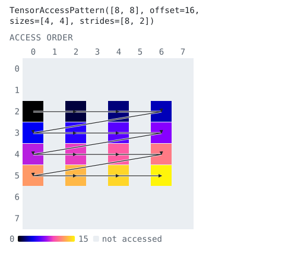</picture></p>
<!-- tapbook:end -->

```python
# A transpose reverses the dimensions
transposed = TensorAccessPattern.full((4, 8)).T
print(transposed)
transposed.visualize(show_arrows=True)
```
<!-- tapbook:begin -->
```text
TensorAccessPattern([4, 8], offset=0, sizes=[8, 4], strides=[1, 8])
```

<p align="center"><picture><source media="(prefers-color-scheme: dark)" srcset="assets/introduction-other-views-2.dark.svg">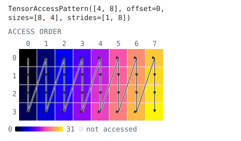</picture></p>
<!-- tapbook:end -->

```python
# coalesce() merges contiguous dimensions: a row of 4 x 16 tiles over a 16 x 16 tensor is one contiguous run of 64 elements
print(TensorAccessPattern.full((16, 16)).tile((4, 16))[0])
print(TensorAccessPattern.full((16, 16)).tile((4, 16))[0].coalesce())
```
<!-- tapbook:begin -->
```text
TensorAccessPattern([16, 16], offset=0, sizes=[1, 4, 16], strides=[0, 16, 1])
TensorAccessPattern([16, 16], offset=0, sizes=[64], strides=[1])
```
<!-- tapbook:end -->

```python
# Reading a buffer of 2 x 4 tiles back in row-major order
blocked = TensorAccessPattern.full((8, 8)).tile((2, 4))
print(blocked.inverse())
blocked.inverse().visualize(show_arrows=True)
```
<!-- tapbook:begin -->
```text
TensorAccessPattern([8, 8], offset=0, sizes=[4, 2, 2, 4], strides=[16, 4, 8, 1])
```

<p align="center"><picture><source media="(prefers-color-scheme: dark)" srcset="assets/introduction-other-views-3.dark.svg">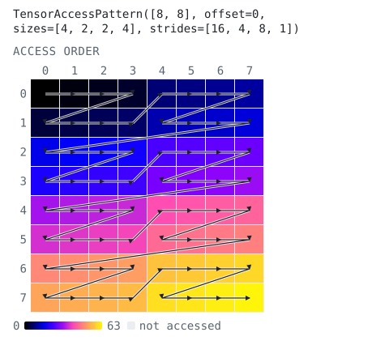</picture></p>
<!-- tapbook:end -->

```python
# transformation_dims holds the (size, stride) pairs a tap stands for as an ObjectFifo's to_stream / from_stream_per_cons
print(group.transformation_dims)
```
<!-- tapbook:begin -->
```text
((2, 64), (2, 4), (4, 16), (4, 1))
```
<!-- tapbook:end -->

That concludes part 1. [Part 2](part2.md) builds on these patterns.

## Running these pages

The code blocks on this page and on [part 2](part2.md) run in order as one
script. With the mlir-aie environment set up (`utils/setup_env.sh`):

```bash
make run          # runs the code blocks of both pages
```

The pictures are generated from the same blocks by
`iron-explorer tapbook README.md`. Each one is written in under its block
between `tapbook` comments, so the page stays in step with its code.
