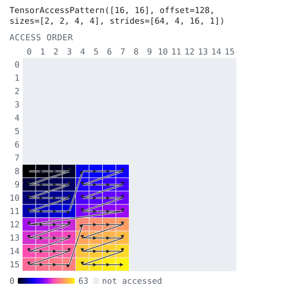
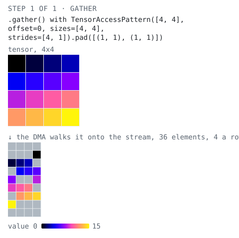

<!-- Copyright (C) 2026 Advanced Micro Devices, Inc.
SPDX-License-Identifier: Apache-2.0 WITH LLVM-exception -->

# `taplib`, part 2: from patterns to data paths

[Part 1](README.md) built single patterns: tiles, groups of tiles, permutes and
slices. This part covers what a design needs next:

* tiling inside a tile, and splitting and merging dimensions
* how many dimensions a DMA can walk, and what a walk of sub-word data must look like
* padding a stream on a memtile
* chaining patterns with `gather()` and `scatter()` to follow data from the host to a core, without hardware
* patterns whose sizes and offsets are only known when the design is called

Every picture on this page is drawn from the code block above it. In the data
path pictures, each element is colored by its value. The host tensors are
`np.arange(...)`, so a color says where an element started.

```python
import numpy as np
from aie.helpers.taplib import TensorAccessPattern
```

## Tiles inside tiles

Tiling a tiled pattern tiles hierarchically. `tiles.tile((1, 1, 4, 4))` keeps
the grid of `8 x 8` tiles and cuts each tile into `4 x 4` sub-tiles. The walk
goes tile by tile and, inside each tile, sub-tile by sub-tile. Each frame below
is one `8 x 8` tile.

```python
tiles = TensorAccessPattern.full((16, 16)).tile((8, 8))
sub = tiles.tile((1, 1, 4, 4))
print(sub)
sub.animate(frame_dims=2)
```
<!-- tapbook:begin -->
```text
TensorAccessPattern([16, 16], offset=0, sizes=[2, 2, 2, 2, 1, 1, 4, 4], strides=[128, 8, 64, 4, 128, 8, 16, 1])
```

<p align="center"><picture><source media="(prefers-color-scheme: dark)" srcset="assets/part2-tiles-inside-tiles-1.dark.svg"></picture></p>
<!-- tapbook:end -->

`tiles[i, j].tile((4, 4))` does the same for one tile:

```python
tiles[1, 0].tile((4, 4)).visualize()
```
<!-- tapbook:begin -->
<p align="center"><picture><source media="(prefers-color-scheme: dark)" srcset="assets/part2-tiles-inside-tiles-2.dark.svg"></picture></p>
<!-- tapbook:end -->

## Splitting and merging dimensions

`split(dim, inner)` cuts one dimension in two, and `merge(dim)` joins a
dimension with the next one. `merge()` is only legal when the two are
contiguous, that is when the outer stride is the inner size times the inner
stride, so the walk stays the same.

```python
rows = TensorAccessPattern.full((8, 8)).split(1, 4)
print(rows)
print(rows.merge(1))
try:
    tiles.merge(1)  # a grid column steps 8 elements, but the rows of a tile are 16 apart
except ValueError as err:
    print("ValueError:", err)
```
<!-- tapbook:begin -->
```text
TensorAccessPattern([8, 8], offset=0, sizes=[8, 2, 4], strides=[8, 4, 1])
TensorAccessPattern([8, 8], offset=0, sizes=[8, 8], strides=[8, 1])
ValueError: dimensions 1 and 2 are not contiguous (stride 8 != 8 * 16); cannot merge
```
<!-- tapbook:end -->

## How many dimensions a DMA walks

A buffer descriptor walks at most four dimensions on a memtile and three on a
core tile. `coalesce()` gives the fewest dimensions that walk the same
elements in the same order. The hierarchical tiling above still needs six,
so a shim `fill()` or `drain()` with it is split into several transfers. An
`ObjectFifo` pattern has to fit in one descriptor.

```python
print(sub.coalesce())
print("dimensions after coalesce():", sub.coalesce().rank)
print("one tile of it:", sub[0, 0].coalesce().rank)
```
<!-- tapbook:begin -->
```text
TensorAccessPattern([16, 16], offset=0, sizes=[2, 2, 2, 2, 4, 4], strides=[128, 8, 64, 4, 16, 1])
dimensions after coalesce(): 6
one tile of it: 4
```
<!-- tapbook:end -->

## What a DMA can walk

A DMA moves whole 4-byte words. taplib accepts any walk, and the compiler
rejects one the hardware cannot do when it lowers the design:

* Every size, and every stride other than an innermost 1, must span whole
  words. A bf16 run is an even number of elements, and an int8 run a multiple
  of four.
* The innermost dimension steps a word at a time. For elements narrower than
  32 bits, its stride must be 1.

So for bf16 or int8 data, `.T` and `permute()` of a tile are rejected, and so
is a `::2` slice of the innermost dimension. To transpose sub-word data, let
the DMA move `s x s` blocks whose rows are whole words, and transpose each
block in the kernel. The transpose chain below does exactly this. The
[taplib reference](../../../../docs/api/taplib.md#what-a-dma-can-walk) shows
the errors the compiler gives.

## Padding a stream

A memtile can pad the stream it emits. `pad()` takes one `(before, after)`
pair per dimension, and `padded_sizes` is the shape the receiving object must
have. `gather(tensor)` returns the stream a DMA walking `tensor` emits, with
`pad_value` in the padded positions (grey below).

```python
padded = TensorAccessPattern.full((4, 4)).pad([(1, 1), (1, 1)])
print(padded, padded.padded_sizes)
print(padded.gather(np.arange(16), pad_value=-1).reshape(padded.padded_sizes))
```
<!-- tapbook:begin -->
```text
TensorAccessPattern([4, 4], offset=0, sizes=[4, 4], strides=[4, 1]).pad([(1, 1), (1, 1)]) (6, 6)
```

<p align="center"><picture><source media="(prefers-color-scheme: dark)" srcset="assets/part2-padding-a-stream-1.dark.svg"></picture></p>

```text
[[-1 -1 -1 -1 -1 -1]
 [-1  0  1  2  3 -1]
 [-1  4  5  6  7 -1]
 [-1  8  9 10 11 -1]
 [-1 12 13 14 15 -1]
 [-1 -1 -1 -1 -1 -1]]
```
<!-- tapbook:end -->

## Following data from the host to a core

On its way from the host to a core, a tensor passes through up to four DMAs,
each walking it with its own pattern: the shim reads the host tensor onto the
stream, the memtile writes it into an object, the memtile reads that object
back out, and the core writes it into its own object. On hardware a mistake
in any of them just looks like scrambled data in the kernel.

`gather(tensor)` is what a DMA reading `tensor` with a pattern emits, and
`scatter(stream)` is the object a DMA writing `stream` with a pattern stores.
Chaining them with a design's patterns shows exactly what each core receives.

The simplest chain: the shim walks a `8 x 8` host tensor tile by tile, and the
memtile stores each `4 x 4` tile row by row.

```python
host = np.arange(64).reshape(8, 8)
shim = TensorAccessPattern.full((8, 8)).tile((4, 4))
stream = shim.gather(host)
tile_0 = TensorAccessPattern.full((4, 4)).scatter(stream[:16])
print(tile_0)
```
<!-- tapbook:begin -->
<p align="center"><picture><source media="(prefers-color-scheme: dark)" srcset="assets/part2-following-data-from-the-host-to-a-core-1.dark.svg"></picture></p>

```text
[[ 0  1  2  3]
 [ 8  9 10 11]
 [16 17 18 19]
 [24 25 26 27]]
```
<!-- tapbook:end -->

### A transpose in two steps

This is the `transposes` design's `--strategy=combined` path (smaller here).
The memtile shuffles each `m x n` tile into `s x s` blocks, so the kernel
only has to transpose each block in place. The last step checks every tile
against NumPy's transpose.

```python
M, K, m, n, s = 16, 16, 8, 8, 4
host = np.arange(M * K).reshape(M, K)
shim = TensorAccessPattern.full((M, K)).tile((m, n))
memtile_in = TensorAccessPattern.full((n, m)).tile((s, s)).permute((1, 2, 0, 3))

for t, tile in enumerate(shim.gather(host).reshape(-1, m * n)):
    i, j = divmod(t, K // n)
    obj = memtile_in.scatter(tile)  # the memtile's (n, m) object
    blocks = obj.reshape(n // s, s, m // s, s)
    kernel_out = blocks.transpose(0, 3, 2, 1).reshape(n, m)
    assert (kernel_out == host[i * m : (i + 1) * m, j * n : (j + 1) * n].T).all()
print("every tile arrives ready for an in-place block transpose")
```
<!-- tapbook:begin -->
<p align="center"><picture><source media="(prefers-color-scheme: dark)" srcset="assets/part2-a-transpose-in-two-steps-1.dark.svg"></picture></p>

```text
every tile arrives ready for an in-place block transpose
```
<!-- tapbook:end -->

### The whole-array GEMM's A operand

In the [whole-array matrix multiply](../../matrix_multiplication/whole_array/README.md),
the shim moves a row of `(m * rows) x k` tiles of A to a memtile. The memtile
splits each one into an `m x k` block per core row, and each core receives its
block as `r x s` microtiles, the layout its kernel multiplies.

```python
M, K, m, k, r, s, rows = 32, 16, 8, 8, 2, 4, 2
host = np.arange(M * K).reshape(M, K)
A_tiles = TensorAccessPattern.full((M, K)).tile((m * rows, k))
micro = TensorAccessPattern.full((m, k)).tile((r, s))
for tile, obj in enumerate(A_tiles[0].gather(host).reshape(-1, m * rows * k)):
    for row in range(rows):
        block = obj[row * m * k : (row + 1) * m * k]  # one core row's m x k block
        core = micro.gather(block).reshape(m, k)
        want = host[row * m : (row + 1) * m, tile * k : (tile + 1) * k]
        want = want.reshape(m // r, r, k // s, s).transpose(0, 2, 1, 3)
        assert (core == want.reshape(m, k)).all()
print("each core receives r x s microtiles")
```
<!-- tapbook:begin -->
<p align="center"><picture><source media="(prefers-color-scheme: dark)" srcset="assets/part2-the-whole-array-gemm-s-a-operand-1.dark.svg"></picture></p>

```text
each core receives r x s microtiles
```
<!-- tapbook:end -->

## Checking that two walks agree

`compare_access_orders()` tells whether two patterns visit the same elements
in the same order, however they are written. A hand-written pattern from an
older design can be checked against the one taplib builds:

```python
by_hand = TensorAccessPattern((16, 16), 0, [2, 2, 8, 8], [128, 8, 16, 1])
print(by_hand.compare_access_orders(tiles))
print(by_hand.compare_access_orders(tiles.permute((1, 0, 2, 3))))
```
<!-- tapbook:begin -->
```text
True
False
```
<!-- tapbook:end -->

## Patterns known only when the design is called

Every operation also accepts staged values: an `aie.ir.Value`, such as a
`DispatchTime[T]` scalar a runtime sequence receives, can stand in for a
size, stride, offset, index, slice bound or repeat count. The arithmetic is
emitted where the pattern is used, and each check that would raise
`ValueError` becomes a guard the host checks before it runs the call. This
needs a design to generate, so the code below is shown but not run here:

```python skip
def seq(a_h, b_h, start, n, in_prod, out_cons):
    # The buffer as max_tiles equal chunks; the chunk index is staged
    # arithmetic (start + loop iv), so the tap's offset is too.
    chunks = TensorAccessPattern.full((max_tiles * tile_size,)).partition(max_tiles)
    for tile in range_(n):
        tap = chunks[start + tile]
        tg = TaskGroup()
        out_cons.drain(b_h, tap=tap, wait=True, group=tg)
        in_prod.fill(a_h, tap=tap, group=tg)
        tg.finish()
```

The structure of a pattern stays a Python value: its rank, slice steps,
padding amounts, and the dimensions `merge()` combines. See
[Staged patterns](../../../../docs/api/taplib.md#staged-patterns-in-a-dispatch-time-sequence)
in the reference for the rules, and `whole_array.py` for a full design
written this way.

That concludes part 2.
